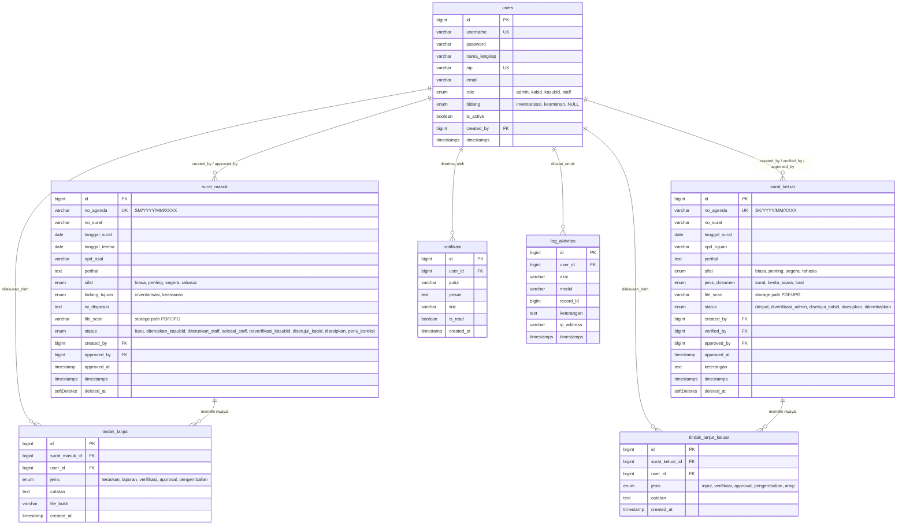
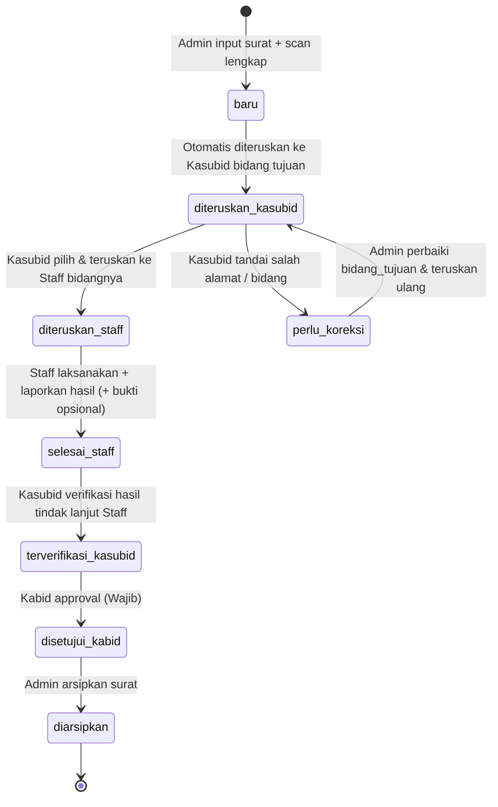
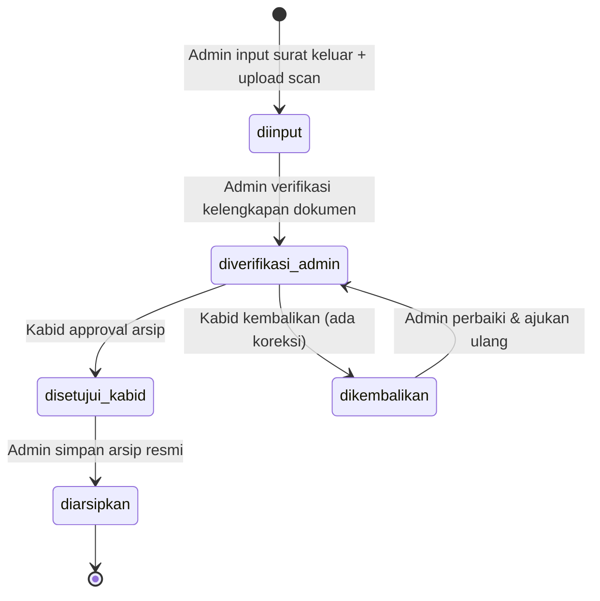

# Rencana Implementasi SIMANSUR (Sistem Manajemen Surat)
**BPKAD Sub Bidang Aset Kota Pekanbaru**

---

## 1. Ringkasan Proyek & Prinsip Utama
SIMANSUR adalah sistem internal tata kelola persuratan digital berbasis web untuk BPKAD Sub Bidang Aset Kota Pekanbaru dengan nuansa formal, bersih, dan aman (mengacu pada standar aplikasi persuratan nasional seperti SRIKANDI / e-Office Pemda).

### Prinsip Inti:
1. **Single Scan as Source of Truth**: Satu berkas scan lengkap (PDF multi-halaman berisi surat fisik, lembar disposisi eksternal, BAST, dan Berita Acara) diunggah di awal dan menjadi acuan utama. Input data hanya menangkap metadata penting untuk pencarian, filter, pelaporan, dan alur disposisi.
2. **Disposisi Selesai di Luar Sistem**: Disposisi pimpinan (Kaban/Sekban) telah dilakukan secara fisik/eksternal. Sistem mencatat ringkasan isi disposisi dan meneruskan ke level teknis (Kasubid → Staff).
3. **Approval Kabid WAJIB**: Setiap surat masuk dan surat keluar WAJIB mendapatkan persetujuan (approval) Kepala Bidang sebelum dapat diarsipkan secara resmi oleh Admin.
4. **Role-Based Access Control (RBAC) Ketat**: Hak akses dibatasi per role (Admin, Kabid, Kasubid Inventarisasi/Keamanan, Staff Inventarisasi/Keamanan).

---

## 2. Arsitektur Teknologi

| Layer | Teknologi & Pustaka | Keterangan |
|---|---|---|
| **Backend** | Laravel 11.x, PHP 8.3 | MVC, RESTful API, Sanctum Auth, Policy & Middleware |
| **Database** | MySQL | InnoDB, Foreign Key Constraints, Transactions, Soft Deletes |
| **Frontend** | React 18, Vite | SPA terintegrasi di dalam Laravel (`resources/js`) |
| **Styling** | Tailwind CSS v3 + Custom CSS | Design system palet formal Pemkot Pekanbaru (#1A3A5C, #2E5C8A, #F5A623) |
| **State & Fetching** | Zustand + TanStack Query v5 | Global state (auth, notifications) + server-state caching |
| **Forms & Validation** | React Hook Form + Zod | Validasi client-side paralel dengan Laravel Form Request |
| **Icons & Charts** | Lucide React + Recharts | Bebas emoji, ikon clean, grafik tren 7-hari & per-bidang |
| **Animasi** | Framer Motion | Smooth transitions, modal scale-in, timeline draw, count-up stats |
| **Export Dokumen** | `barryvdh/laravel-dompdf` + `maatwebsite/excel` | Cetak agenda disposisi & laporan rekap bulanan/tahunan |
| **Activity Logging** | `spatie/laravel-activitylog` | Audit trail otomatis per mutasi data & status |

---

## 3. Skema Basis Data & Relasi

---

## 4. Alur Kerja (Workflows) & State Machine

### 4.1. Alur Surat Masuk (Turun)

### 4.2. Alur Surat Keluar (Naik)

---

## 5. Matriks Hak Akses & Peran (RBAC)

| Modul / Tindakan | Admin | Kabid | Kasubid (Inv/Keam) | Staff (Inv/Keam) |
|---|:---:|:---:|:---:|:---:|
| **Dashboard** | Statistik Global, All Feed | Monitoring Global, Chart Approval | Statistik Bidangnya | Surat Masuk Tugasnya |
| **Surat Masuk: Input** | ✅ Ya | ❌ Tidak | ❌ Tidak | ❌ Tidak |
| **Surat Masuk: Koreksi Disposisi** | ✅ Ya (edit bidang) | ❌ Tidak | ✅ Tandai Koreksi | ❌ Tidak |
| **Surat Masuk: Teruskan ke Staff** | ❌ Tidak | ❌ Tidak | ✅ Ya (ke staff bidangnya) | ❌ Tidak |
| **Surat Masuk: Tindak Lanjut** | ❌ Tidak | ❌ Tidak | ❌ Tidak | ✅ Ya (input laporan) |
| **Surat Masuk: Verifikasi Staff** | ❌ Tidak | ❌ Tidak | ✅ Ya (verifikasi laporan) | ❌ Tidak |
| **Surat Masuk: Approval** | ❌ Tidak | ✅ Ya (Wajib) | ❌ Tidak | ❌ Tidak |
| **Surat Masuk: Arsipkan** | ✅ Ya (stlh Kabid approve) | ❌ Tidak | ❌ Tidak | ❌ Tidak |
| **Surat Keluar: Input & Verifikasi** | ✅ Ya | ❌ Tidak | ❌ Tidak | ❌ Tidak |
| **Surat Keluar: Approval** | ❌ Tidak | ✅ Ya (Wajib) | ❌ Tidak | ❌ Tidak |
| **Surat Keluar: Monitoring** | ✅ Ya | ✅ Ya | ✅ Read-only | ❌ Tidak |
| **Surat Keluar: Arsipkan** | ✅ Ya (stlh Kabid approve) | ❌ Tidak | ❌ Tidak | ❌ Tidak |
| **Manajemen User** | ✅ Semua User | ❌ Tidak | ✅ Registrasi Staff Bidang | ❌ Tidak |
| **Laporan & Export** | ✅ Semua Bidang | ✅ Semua Bidang | ✅ Bidang Sendiri | ❌ Tidak |
| **Log Aktivitas** | ✅ Ya | ❌ Tidak | ❌ Tidak | ❌ Tidak |

---

## 6. Desain Visual & UI/UX Standards

### 6.1. Brand & Color Palette
- **Primary**: `#1A3A5C` (Deep Government Navy)
- **Secondary**: `#2E5C8A` (Medium Classic Blue)
- **Accent**: `#F5A623` (Official Warm Amber / Gold)
- **Background App**: `#F5F7FA` (Neutral Government Off-white)
- **Card & Surface**: `#FFFFFF` dengan shadow lembut `0 1px 3px rgba(0,0,0,0.08)`
- **Border**: `#E5E7EB`
- **Text Primary**: `#1F2937`, **Text Secondary**: `#6B7280`
- **Status Colors**:
  - Hijau Sukses: `#10B981` (`diarsipkan`, `disetujui_kabid`, `selesai_staff`)
  - Kuning/Amber: `#F59E0B` (`baru`, `diteruskan_kasubid`, `diteruskan_staff`, `diverifikasi_admin`)
  - Merah/Bahaya: `#EF4444` (`perlu_koreksi`, `dikembalikan`)
  - Netral Biru: `#2E5C8A` (`terverifikasi_kasubid`)

### 6.2. Komponen UI Khas Pemerintah
1. **Header Instansi**: Identitas resmi BPKAD Kota Pekanbaru Sub Bidang Aset dengan lambang Kota Pekanbaru (clean vector SVG).
2. **Document Viewer Split View**: Layar detail 2-kolom:
   - Kolom kiri: Ringkasan metadata surat, informasi disposisi fisik, formulir aksi sesuai role, dan timeline tindak lanjut.
   - Kolom kanan: PDF/Doc Viewer interaktif dengan fitur Zoom In, Zoom Out, Reset, Rotate, dan Download.
3. **Timeline Disposisi Animatif**: Stepper vertikal dengan connector line dan pulsing active node yang menunjukkan jejak mutasi dari awal masuk hingga arsip.
4. **Data Table Cepat & Informatif**: Filter multi-kriteria (status, tanggal, sifat, OPD), debounce search (300ms), badge status dengan dot indicator, dan pagination responsif.

---

## 7. Rincian Langkah Eksekusi (Implementation Steps)

### Tahap 1: Inisialisasi Proyek & Konfigurasi Basis
- Buat proyek Laravel 11 di direktori kerja `d:/simansur2`.
- Konfigurasi `.env` ke MySQL (`127.0.0.1:3306`, user `root`, database `simansur_bpkad`).
- Pasang paket composer:
  - `laravel/sanctum`
  - `barryvdh/laravel-dompdf`
  - `maatwebsite/excel`
  - `spatie/laravel-activitylog`
- Setup Vite + React 18 di `resources/js`:
  - Pasang: `tailwindcss`, `lucide-react`, `framer-motion`, `@tanstack/react-query`, `zustand`, `react-hook-form`, `zod`, `@hookform/resolvers`, `recharts`, `axios`, `clsx`, `tailwind-merge`.
  - Konfigurasi `vite.config.js` dan `tailwind.config.js`.

### Tahap 2: Database Migration, Model & Seeders
- Buat migrations untuk tabel `users`, `surat_masuk`, `surat_keluar`, `tindak_lanjut`, `tindak_lanjut_keluar`, `notifikasi`, `log_aktivitas`.
- Terapkan model Eloquent dengan cast, relasi, query scopes, dan soft delete.
- Buat seeder akun default:
  - **Admin**: `username: admin`, `nip: 198001012005011001`, `nama: Administrator Sistem`
  - **Kabid**: `username: kabid.aset`, `nip: 197508121998031002`, `nama: Drs. H. Ahmad Fauzi, M.Si`
  - **Kasubid Inventarisasi**: `username: kasubid.inv`, `nip: 198203152006041005`, `nama: Budi Santoso, S.STP`
  - **Kasubid Keamanan**: `username: kasubid.keam`, `nip: 198406202008011003`, `nama: Hendra Wijaya, S.E`
  - **Staff Inventarisasi**: `username: staff.inv`, `nip: 199201102015031002`, `nama: Siti Rahmawati, S.Tr.A.P`
  - **Staff Keamanan**: `username: staff.keam`, `nip: 199407252019021004`, `nama: Rian Pratama, A.Md`
  - Password default semua akun: `password123`
- Tambahkan sampel data surat masuk & surat keluar dengan berbagai status awal untuk verifikasi instan.

### Tahap 3: Backend API, Policy & Services
- **Auth & Profile API**: Login Sanctum, logout, user session info, ganti password.
- **Middleware & Guard**: Role middleware (`CheckRole:admin,kabid,...`), status authorization checks.
- **Surat Masuk Controller**:
  - `index`, `store` (auto-number `SM/YYYY/MM/XXXX`, upload multi-page PDF), `show`, `update`, `destroy`.
  - `teruskanKasubid`, `koreksiBidang`, `teruskanStaff`, `laporStaff`, `verifikasiKasubid`, `approveKabid`, `arsipkan`.
- **Surat Keluar Controller**:
  - `index`, `store` (auto-number `SK/YYYY/MM/XXXX`, upload PDF), `show`, `verifikasiAdmin`, `approveKabid`, `kembalikanKabid`, `arsipkan`.
- **User Management Controller**: Khusus Admin (full CRUD) & Kasubid (register staff di bidangnya).
- **Laporan & Export Controller**: Laporan rekapitulasi, cetak PDF disposisi, export Excel rekap surat masuk/keluar.
- **Notifikasi & Log Aktivitas**: Real-time notification endpoint, mark as read, audit trail viewer.

### Tahap 4: Frontend React Architecture & UI System
- **Layout & Navigasi**:
  - Government Header dengan profile info, notifications popover, breadcrumbs dinamis.
  - Sidebar collapsible (260px → 72px) yang menyesuaikan menu dengan role yang sedang aktif.
  - Content container yang elegan dan nyaman di mata (WCAG AA compliant).
- **Halaman Login**:
  - Split layout bertema Pemerintahan Kota Pekanbaru, SVG line art BPKAD Aset, form validasi Zod.
- **Dashboard per Role**:
  - Stat cards (Total Masuk, Butuh Tindak Lanjut, Menunggu Approval, Diarsipkan) dengan animasi count-up.
  - Grafik tren persuratan 7 hari & distribusi disposisi per OPD/Sifat (Recharts).
  - Quick action feeds: daftar dokumen prioritas yang menunggu aksi user saat ini.
- **Modul Surat Masuk**:
  - List table dengan quick tabs (`Semua`, `Perlu Tindakan Saya`, `Selesai`).
  - Form Input: 9 field penting + file upload drag & drop (preview halaman pertama/icon PDF).
  - Detail View: Two-panel view (Metadata & action di kiri, responsive PDF Viewer di kanan).
  - Modal aksi: Teruskan ke staff (pilihan dropdown staff aktif), Lapor hasil (dengan upload bukti), Approval Kabid, Catatan koreksi.
- **Modul Surat Keluar**:
  - List table, Form input + upload berkas lengkap.
  - Detail view dengan timeline proses verifikasi admin → approval kabid → arsip.
- **Modul Manajemen User, Laporan, & Log Aktivitas**:
  - Tabel user + modal tambah/edit.
  - Filter rentang tanggal laporan, filter OPD/sifat, tombol cetak PDF & unduh Excel.
  - Log aktivitas tabular dengan filter waktu, user, dan modul.

### Tahap 5: Storage Link & Integrasi Dokumen
- Jalankan `php artisan storage:link`.
- Pastikan berkas scan disimpan aman di `storage/app/public/surat-masuk` dan `storage/app/public/surat-keluar`.
- Penanganan URL publik yang aman dan preview inline PDF via iframe/embed object dengan toolbar kontrol.

### Tahap 6: Pengujian End-to-End & Dokumentasi
- Uji alur surat masuk dari Admin → Kasubid → Staff → Kasubid → Kabid → Admin (Arsip).
- Uji alur pengembalian surat masuk (`perlu_koreksi`) dari Kasubid ke Admin.
- Uji alur surat keluar dari Admin → Admin verifikasi → Kabid approve → Admin (Arsip).
- Uji alur penolakan/pengembalian surat keluar oleh Kabid.
- Uji ekspor PDF dan Excel.
- Tuliskan panduan setup & kredensial login di `README.md`.

---

## 8. Verifikasi Kesiapan Lingkungan
- PHP Version: **8.3.16** (Tersedia)
- Composer: **2.8.9** (Tersedia)
- Node.js: **v22.15.0** (Tersedia)
- NPM: **10.9.2** (Tersedia)
- Database: **MySQL 127.0.0.1:3306** (Teruji Aktif & Terhubung)
